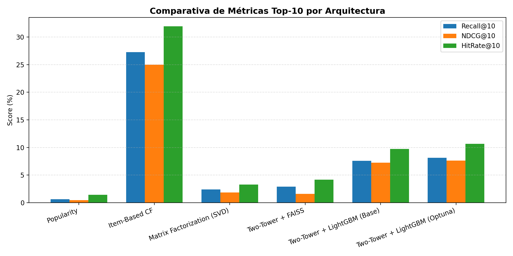
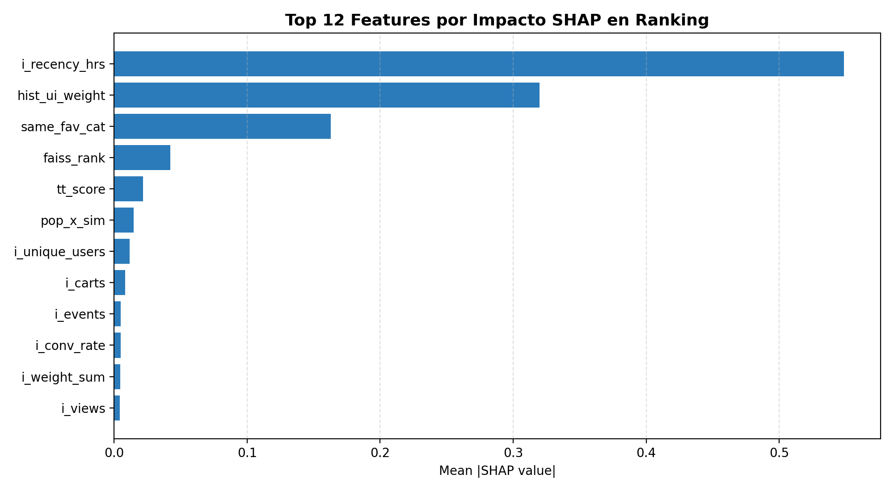

# End-to-End E-Commerce Recommendation System (Two-Tower + FAISS + LightGBM)

Sistema de recomendación multietapa (*Retrieval & Ranking*) construido sobre el dataset de comportamiento real de **Retailrocket E-Commerce**. El pipeline resuelve el problema de recomendación a escala combinando recuperación vectorial densa mediante redes neuronales **Two-Tower** indexadas en **FAISS** y re-ranking supervisado mediante **Learning-to-Rank (LightGBM + Optuna)**.

---

## Arquitectura del Pipeline

```text
[Raw Events & Item Properties]
        │
        ▼
1. Data Processing & Sessionization (K-Core filtering, temporal split sin leakage)
        │
        ▼
2. Behavioral Feature Engineering (RFM-like recency, conversion rates, category affinity)
        │
        ├──► 3. Baselines (Popularity, Item-Based CF, TruncatedSVD)
        │
        ▼
4. Candidate Generation (Two-Tower PyTorch Net + In-Batch Contrastive Loss)
        │
        ▼
5. Vector Retrieval (FAISS IndexFlatIP -> Top-100 candidatos en <1 ms)
        │
        ▼
6. Learning-to-Rank (LightGBM LambdaMART + Optuna Tuning + SHAP Explainability)
        │
        ▼
7. Top-10 Personalized Recommendations
```

---

## Benchmark de Resultados (Top-10)

Evaluación realizada bajo un esquema temporal estricto (*out-of-time split* sobre los últimos 7 días) excluyendo ítems ya comprados en entrenamiento:

| Modelo / Etapa | Recall@10 (%) | Precision@10 (%) | NDCG@10 (%) | MAP@10 (%) | HitRate@10 (%) |
| :--- | :---: | :---: | :---: | :---: | :---: |
| **Popularity Baseline** | 0.635 | 0.150 | 0.455 | 0.308 | 1.420 |
| **Matrix Factorization (SVD)** | 2.422 | 0.443 | 1.834 | 1.483 | 3.287 |
| **Two-Tower + FAISS (Retrieval)** | 2.891 | 0.482 | 1.615 | 1.036 | 4.162 |
| **Two-Tower + LightGBM (Base)** | 7.579 | 1.198 | 7.253 | 6.592 | 9.743 |
| **Two-Tower + LightGBM (Optuna)** | **8.116** | **1.317** | **7.628** | **6.873** | **10.657** |
| **Item-Based CF (Exact Cosine)** | 27.252 | 3.785 | 24.975 | 23.064 | 31.933 |

### Análisis Técnico de Resultados
* **Impacto del Re-Ranking (LTR):** Incorporar el ranker **LightGBM (LambdaRank)** optimizado con **Optuna** sobre los 100 candidatos recuperados por FAISS multiplicó el **NDCG@10 por 4.7x** (`1.615%` $\rightarrow$ `7.628%`) y elevó el **Recall@10 en +180.7%** (`2.891%` $\rightarrow$ `8.116%`) frente a la etapa pura de recuperación neuronal.
* **Escalabilidad vs. Memorización (Two-Tower vs. Item-CF):** En e-commerce de sesiones cortas, *Item-Based CF* obtiene métricas altas debido al sesgo de repetición de vistas sobre los mismos productos recientes, pero su complejidad cuadrática $O(\vert{}I\vert{}^2)$ impide escalar a catálogos masivos en tiempo real. La arquitectura **Two-Tower + FAISS** desacopla el cómputo de embeddings y permite recuperar candidatos en milisegundos con soporte para atributos de usuario/producto (*cold-start*).

### Visualización de Resultados y Explicabilidad (SHAP)





---

## Estructura del Repositorio

```text
├── notebooks/
│   └── retailrocket_recsys_e2e.ipynb       # Pipeline completo (Fases 1 a 8)
├── src/
│   └── inference.py                        # Clase RetailRocketRecommender para producción
├── artifacts/
│   ├── two_tower_weights.pt                # Pesos de la red neuronal Two-Tower (PyTorch)
│   ├── faiss_item.index                    # Índice vectorial L2-normalizado (FAISS)
│   ├── lgbm_ranker_tuned.txt               # Modelo Learning-to-Rank optimizado
│   ├── scalers.pkl                         # Escaladores y codificación de categorías
│   ├── ltr_meta.pkl                        # Metadatos y features del ranker
│   └── id_mappings.pkl                     # Diccionarios visitorid <-> itemid
├── reports/
│   ├── final_benchmark.csv                 # Métricas comparativas Top-10
│   ├── benchmark_comparison.png            # Gráfico comparativo de arquitecturas
│   └── shap_importance.png                 # Importancia de variables con SHAP
└── requirements.txt
```

---

## Uso Rápido (Inferencia)

```python
from src.inference import RetailRocketRecommender

recommender = RetailRocketRecommender(artifacts_dir="artifacts", data_dir="data")
recommendations, latency_ms = recommender.recommend(visitor_id=1150086, top_k=10)

print(f"Latencia: {latency_ms:.2f} ms")
print(recommendations)
```

---

## Stack Tecnológico
* **Deep Learning & Retrieval:** PyTorch, FAISS (`IndexFlatIP`)
* **Tabular Ranking & Optimization:** LightGBM (`lambdarank`), Optuna, SHAP
* **Data Processing & Tracking:** Pandas, NumPy, SciPy, Scikit-Learn, MLflow, Plotly
